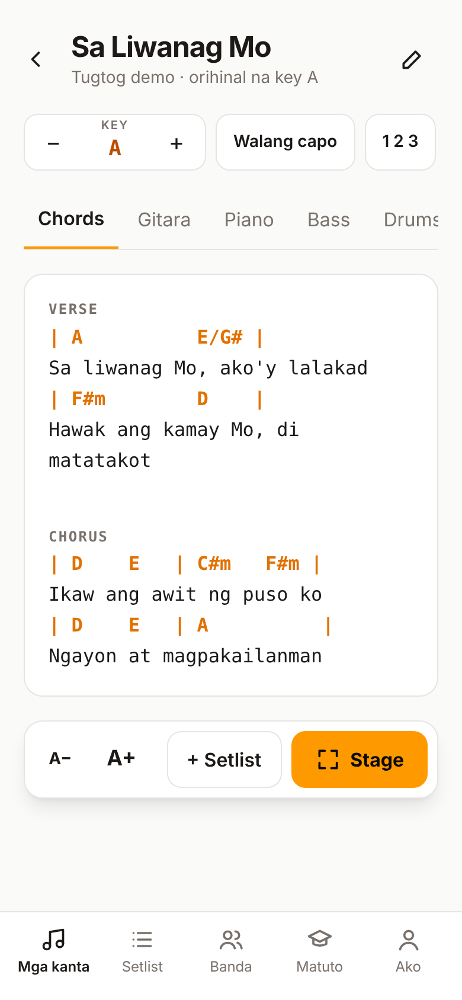
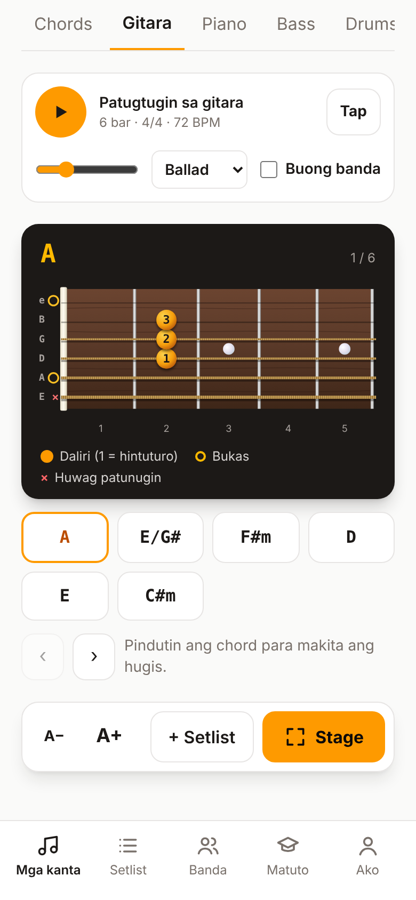
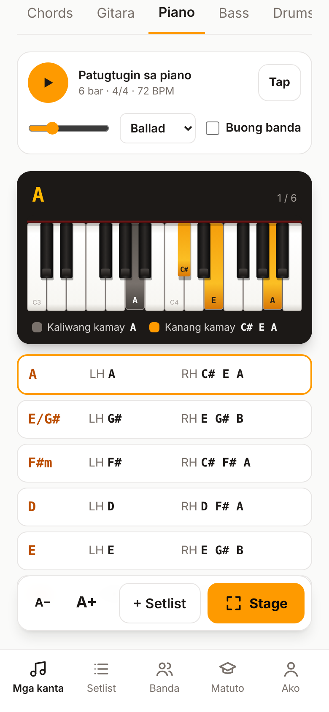
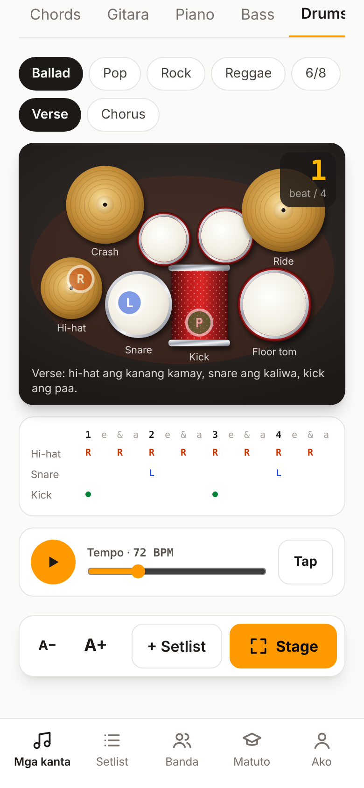
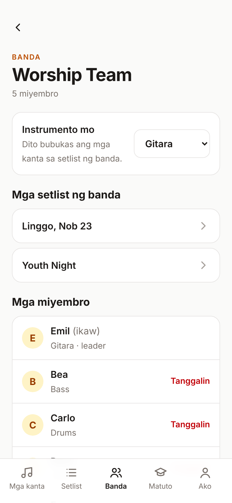
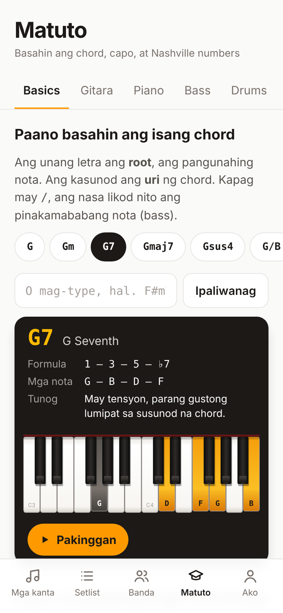

# Tugtog

**Type a song's chords once, and every member of the band gets their own part.** Tugtog is a web app for bands, worship teams, singers, and people learning an instrument. It transposes chord charts with lyrics, shows each chord on a realistic guitar neck, piano keyboard, bass neck, and drum kit, and plays the song back so you can practice along.

**Live app:** https://tugtog-delta.vercel.app/ · The interface is in Filipino (Tagalog).

<p>
  
  
  
</p>
<p>
  
  
  
</p>

## Features

**Chord charts**
- Transpose a whole song with lyrics to any key. Only chord lines change; lyrics stay as written.
- Spells notes the way musicians expect for the key (`Bb` in F, `G#` in `E/G#`) and handles 7ths, sus, add9, and slash chords.
- Capo suggestions for hard keys (Bb → capo 1 with A shapes) and a Nashville number view.
- Bar lines for more than one chord per bar: `| G  D/F# | Em  C |`.
- Stage mode: full-screen view with large text and auto-scroll.

**A part for every instrument**
- **Guitar:** each chord on a realistic neck with finger numbers, open and muted strings, barres, and capo.
- **Piano:** left-hand bass note and right-hand voicing near middle C.
- **Bass:** the root (or slash bass) of each chord on the E and A strings, with tab.
- **Drums:** a top-down kit that lights up on every hit, with grooves for intro, verse, pre-chorus, chorus, bridge, and outro.

**Play-along**
- Plays the song bar by bar on guitar, piano, bass, or the full band, and the neck or keyboard follows along.
- Each song stores its tempo, time signature (4/4 or 6/8), and style (ballad, pop, rock, reggae), and the strum, bass, and drum patterns follow them.
- A song can have its own strum pattern (e.g. `D-DU-UDU`, with `x` for a chuck), shown on the Guitar tab and played by the player.
- Chord timing follows how the chart is written: chords written close together share a bar, and `|` marks exact bars.
- Tap tempo to match a recording.

**Bands and setlists**
- Private song library and setlists with a key per song, plus a public read-only share link.
- Create a band, invite members with a link, and assign instruments. When a bassist opens a song from the band's setlist, it opens on the Bass tab in the setlist's key.

- Users can delete their account and all their data from the account page.

**Lessons**
- How to read a chord symbol, capo, Nashville numbers, the first 8 guitar chords, strum patterns, building piano chords, finding bass notes, and drum grooves, all with sound.

## Tech stack

| Part | Choice |
|---|---|
| Frontend | React 19, TypeScript, Vite, React Router |
| Styling | Tailwind CSS v4 (light and dark mode) |
| Audio | Web Audio API, with no audio files |
| Backend | Supabase: Postgres, auth, row-level security, SQL functions |
| Tests | Vitest (142 unit tests, test-first for the music logic) and Playwright (19 end-to-end tests) |
| Hosting | Vercel, auto-deployed from `main` |

## How it works

**The music engine is plain TypeScript with no UI code** (`src/music/`), so it is easy to test.

- `transpose.ts` decides whether a line holds chords or lyrics, moves each chord's root, and names the new note for the target key.
- `guitar.ts` looks up open shapes and builds barre chords from E and A shapes for any other chord.
- `piano.ts`, `bass.ts`, and `drums.ts` turn a chord into a voicing, a bass position, or a groove.
- `arrangement.ts` turns a style and time signature into a pattern for each instrument. `barEvents` then decides which chord each hit belongs to when a bar holds more than one chord.

**All sound is generated in the browser.**

- **Guitar and bass:** plucked strings use the Karplus–Strong algorithm, a short burst of softened noise fed through a delay line.
- **Piano and drums:** piano notes are layered oscillators, and the drums are shaped noise and sine sweeps.
- **Timing:** notes are scheduled slightly ahead on the audio clock, and the screen follows that clock. This keeps the timing steady even when rendering is slow. The timing was checked by recording the app's output and analyzing it.

**Data access is enforced in the database, not in the app.** Row-level security means users only see their own songs.

- Band members can read, but not change, the setlists shared with their band and the songs in them.
- Joining a band only happens through a `join_team` function that checks the invite code.
- Small `security definer` helper functions keep the policies from referring to each other in a loop.
- `supabase/tests/rls-test.sql` checks the policies with three simulated users: owner, member, and outsider.

## Run it locally

```bash
git clone https://github.com/EmilCalundan/tugtog.git
cd tugtog
npm install
```

1. Create a Supabase project. In the **SQL Editor**, run these files in order:
   1. `supabase/01-songs-setlists.sql`
   2. `supabase/song-settings.sql`
   3. `supabase/teams.sql`
   4. `supabase/delete-account.sql`
   5. `supabase/strum-pattern.sql`
2. Create `.env.local` with your project URL and publishable key:
   ```
   VITE_SUPABASE_URL=https://your-project.supabase.co
   VITE_SUPABASE_PUBLISHABLE_KEY=sb_publishable_...
   ```
3. Start the app and run the tests:
   ```bash
   npm run dev
   npm test            # unit tests (Vitest)
   npx playwright install chromium   # once
   npm run e2e         # end-to-end tests in a real browser
   ```
   The end-to-end tests use a mocked Supabase (`e2e/supabase-mock.ts`), so they never touch a real database.

## Project structure

```
src/
  music/       chord, instrument, groove, and arrangement logic (with tests)
  lib/         Supabase data access, audio engine, and hooks
  components/  guitar neck, piano keyboard, bass neck, drum kit, panels
  pages/       songs, editor, setlists, bands, lessons, account
e2e/           end-to-end tests (Playwright) with a mocked Supabase
supabase/      SQL for tables, policies, and functions
```

## Roadmap

- [x] Chord transposer, capo, and Nashville numbers
- [x] Song library, setlists, and share link
- [x] Parts for guitar, piano, bass, and drums
- [x] Play-along with per-song tempo, time signature, and style
- [x] Bands with invite links and instrument-specific setlists
- [x] Lessons
- [ ] Pilot with a real band
- [ ] Start from any bar, and loop a section
- [ ] Custom email sending for sign-up confirmation

## What I learned

<!-- Isulat ito sa sarili mong salita. Ito ang mga halimbawa; palitan o tanggalin. -->
- Writing the music logic test-first made it safe to change. Bar lines, slash chords, and 6/8 were added without breaking older songs.
- Row-level security moves access rules into the database. Getting policies on three related tables to work without recursion taught me how Postgres evaluates them.
- Browser timers are not precise enough for music; scheduling on the audio clock is.

## Author

Emil Calundan, Computer Science student (Diploma in Application Development) at the University of Makati.
